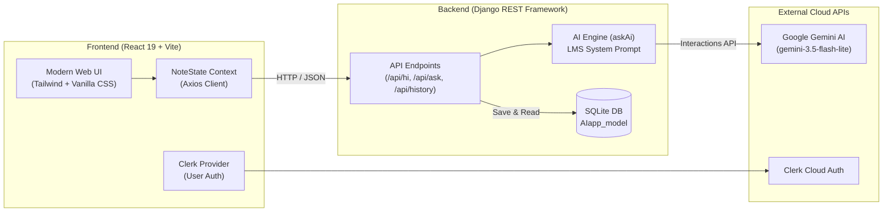

# ⚡ Ultron AI — Full-Stack LMS & Intelligent Learning Assistant

<p align="center">
  
  
  
  
  
  
  
</p>

---

##  Overview

**Ultron AI** is a state-of-the-art full-stack educational AI platform. Built with **Django REST Framework** on the backend and **React + Vite** on the frontend, Ultron acts as an intelligent pedagogical tutor for students and lifelong learners.

Powered by Google's **Gemini AI Interactions API** (`gemini-3.5-flash-lite` / `gemini-3.6-flash`), Ultron doesn't just return raw text — it generates **structured learning roadmaps**, comprehensive concept breakdowns, actionable step-by-step guidance with estimated study durations (e.g. `10 min`), and encouraging wrap-ups.

---

##  Features

-  **Google Gemini AI Engine**: High-throughput, low-latency reasoning using the official `google-genai` Interactions SDK.
-  **Structured LMS Learning Roadmaps**: Responses are automatically parsed into interactive UI cards containing step titles, task descriptions, and time estimates.
-  **Clerk User Authentication**: Pre-configured user management, user session control, sign-in, sign-up, and profile avatar modals.
- **Automatic Database Persistence**: Past inquiries, answers, and timestamps are saved directly to Django's SQLite database.
- **Full-Stack REST Sync**: Real-time heartbeat monitoring between Vite and Django (`/api/hi/`), plus history fetching on startup.
- **Futuristic UI Aesthetics**: Cyberpunk-inspired Jet Black (`#090a0f`), Neon Chartreuse (`#a6ff00`), and Hot Pink (`#ff2a85`) design with micro-animations, glassmorphism, and responsive sidebars.
- **Security First**: Comprehensive `.gitignore` configuration shielding all secrets, `.env` files, and database binaries.

---

##  System Architecture



---

##  API Endpoints Reference

All endpoints are hosted at `http://127.0.0.1:8000/api/` during local development:

| Method | Endpoint | Description | Request Payload | Response Sample |
| :--- | :--- | :--- | :--- | :--- |
| `GET` | `/api/hi/` | Heartbeat & health check | _None_ | `{"status": "online", "message": "Hi! Ultron AI backend API is live."}` |
| `GET` | `/api/get/` | Alias route for health check | _None_ | `{"status": "online", "message": "..."}` |
| `POST` | `/api/ask/` | Submit a student inquiry to Gemini | `{"name": "Anshuman", "question": "Explain binary search"}` | `{"id": 1, "name": "...", "question": "...", "ai_response": "{...}"}` |
| `GET` | `/api/history/` | Fetch recent conversation history | Optional query `?name=Explorer` | `[{"id": 1, "name": "...", "question": "...", "ai_response": "..."}]` |
| `DELETE` | `/api/history/` | Clear chat records from database | Optional query `?name=Explorer` | `{"message": "Successfully deleted records."}` |

---

##  Repository Structure

```text
Django_AI_project/
├── .gitignore                     # Root GitIgnore covering all envs, DBs, and dependencies
├── README.md                      # Primary GitHub repository documentation
├── backend/
│   ├── .env                       # Secret environment variables (Ignored by Git)
│   ├── .env.example               # Safe template for backend variables
│   ├── .gitignore                 # Backend-specific ignore rules
│   ├── manage.py                  # Django CLI management script
│   ├── db.sqlite3                 # SQLite database (Ignored by Git)
│   ├── backend/
│   │   ├── __init__.py
│   │   ├── settings.py            # Environment-aware Django configuration
│   │   ├── urls.py                # Global URL router
│   │   └── wsgi.py
│   └── AIapp/
│       ├── models.py              # AIapp_model (name, question, ai_response, created_at)
│       ├── serializers.py         # DRF Serializer
│       ├── urls.py                # App endpoints (/hi/, /ask/, /history/)
│       ├── utils.py               # Gemini Interactions API & LMS System Prompt
│       └── views.py               # REST API views
└── frontend/
    ├── .env                       # Client environment variables (Ignored by Git)
    ├── .env.example               # Safe template for client variables
    ├── .gitignore                 # Frontend-specific ignore rules
    ├── package.json               # Node dependencies and build scripts
    ├── vite.config.js             # Vite configuration
    └── src/
        ├── App.jsx                # Main application routing
        ├── main.jsx               # ClerkProvider & React entrypoint
        ├── components/
        │   ├── Header.jsx         # Live backend status indicator & Clerk user button
        │   └── Footer.jsx         # Footer component
        ├── context/
        │   └── NoteState.jsx      # Global chat state, history sync & API communication
        └── pages/
            ├── Home.jsx           # Main chat interface with structured LMS cards
            ├── Documentation.jsx  # In-app developer & user manual
            ├── Sign_in.jsx        # Clerk sign-in page
            └── Sign_up.jsx        # Clerk registration page
```

---

##  Environment Variables & Secrets Hygiene

> [!IMPORTANT]
> **Never commit `.env` files into your Git repository.** All `.env` files are excluded by [.gitignore](file:///.gitignore). Use the provided `.env.example` templates to set up your environment.

### Backend (`backend/.env`)

Create `backend/.env` using `backend/.env.example` as a template:

```env
# Django Configuration
SECRET_KEY=your-secure-django-secret-key-here
DEBUG=True
ALLOWED_HOSTS=127.0.0.1,localhost,*
CORS_ALLOWED_ORIGINS=http://localhost:5173,http://127.0.0.1:5173

# Google Gemini API
GEMINI_API_KEY=your_gemini_api_key_here
GEMINI_MODEL=gemini-3.5-flash-lite
```

### Frontend (`frontend/.env`)

Create `frontend/.env` using `frontend/.env.example` as a template:

```env
# Clerk Authentication (Get from https://dashboard.clerk.com/)
VITE_CLERK_PUBLISHABLE_KEY=pk_test_your_clerk_key_here

# Backend Connection
VITE_API_BASE_URL=http://127.0.0.1:8000
```

---

##  Getting Started

### Prerequisites

- **Python**: 3.11 or higher
- **Node.js**: v18.0.0 or higher
- **npm**: v9.0.0 or higher
- **Google Gemini API Key**: Obtainable from [Google AI Studio](https://aistudio.google.com/)
- **Clerk Publishable Key**: Obtainable from [Clerk Dashboard](https://dashboard.clerk.com/)

---

### 1. Backend Setup (Django)

1. **Navigate to the backend directory and activate the virtual environment**:
   ```bash
   cd backend
   # Windows PowerShell:
   ..\.venv\Scripts\Activate.ps1
   # macOS/Linux:
   source ../.venv/bin/activate
   ```

2. **Install required packages** (if starting fresh):
   ```bash
   pip install django djangorestframework django-cors-headers google-genai python-dotenv
   ```

3. **Configure environment variables**:
   ```bash
   # Copy the example env file and add your GEMINI_API_KEY
   cp .env.example .env
   ```

4. **Run migrations to initialize SQLite**:
   ```bash
   python manage.py makemigrations
   python manage.py migrate
   ```

5. **Start the development server**:
   ```bash
   python manage.py runserver 127.0.0.1:8000
   ```
   Backend will be available at [http://127.0.0.1:8000/api/](http://127.0.0.1:8000/api/).

---

### 2. Frontend Setup (React + Vite)

1. **Open a new terminal and navigate to the frontend directory**:
   ```bash
   cd frontend
   ```

2. **Install frontend dependencies**:
   ```bash
   npm install
   ```

3. **Configure environment variables**:
   ```bash
   cp .env.example .env
   ```
   Ensure `VITE_CLERK_PUBLISHABLE_KEY` is filled with your Clerk publishable key.

4. **Start the Vite dev server**:
   ```bash
   npm run dev
   ```
   Open your browser and navigate to [http://localhost:5173/](http://localhost:5173/).

---

##  Testing the Integration

1. Once both servers are running, look at the top navigation bar at [http://localhost:5173/](http://localhost:5173/).
2. You will observe the live status chip glowing green: **`Backend 8000`**.
3. Type an inquiry such as:
   > *"Explain how Merge Sort works in Python"*
4. Ultron will respond with:
   - A friendly greeting
   - The conceptual explanation
   - An organized **Learning Roadmap** with actionable steps and duration estimates (e.g. `⏱ 10 min`)
   - A wrap-up encouraging advice card
5. Your query will automatically persist to the SQLite database and appear in the **Recent** sidebar!

---

##  Author & Credits

- **Creator & Lead Developer**: [Anshuman Patidar](https://github.com/)
- **AI Engine**: Google Gemini API (`google-genai` SDK)
- **Authentication**: [Clerk](https://clerk.com/)
- **Frameworks**: Django REST Framework & React / Vite

---

## License

This project is licensed under the [MIT License](LICENSE).
